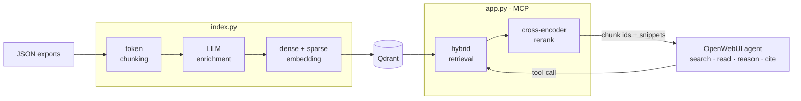

<p align="center">
  
</p>

<h1 align="center">A-RAG-OG</h1>

<p align="center">
  <b>Agentic RAG, Off Grid</b> — a self-hosted retrieval <b>MCP server</b> for OpenWebUI.
</p>

<p align="center">
  
  
  
  
  
</p>

---

## ✨ What it is

A-RAG-OG indexes JSON exports of documents that live on a website into a single hybrid
(dense + sparse) Qdrant store and exposes retrieval as MCP tools. The agent lives in
OpenWebUI — its model decides which tool to call, searches in several rounds, reads promising
chunks and grounds its answer with links to the website. This service stays a thin,
stateless retrieval layer. Off grid means it: every bundled service runs with telemetry and
update checks switched off.

Enrichment adds context, keywords, hypothetical questions, entities and dates to every
chunk. Context, keywords, questions and the document metadata go into the embeddings;
keywords, entities, document metadata and mentioned dates are what `filtered_search`
filters on.



---

## 🚀 Quick Start

One compose file runs the whole stack: MCP server, Qdrant, embedder and reranker.
**Requires** Docker, plus the NVIDIA container toolkit for the bundled embedder and reranker.
The embedder is any OpenAI-compatible `/embeddings` endpoint and the reranker any `/rerank`
endpoint in vLLM's format, so pointing `DENSE_EMBEDDING_URL` / `RERANKER_URL` at an external
service drops both the GPU and those two containers.

### 1. Configure

```bash
git clone https://github.com/Th3R3alDuk3/Aragog.git
cd Aragog
cp .env.example .env
```

Everything is configured in `.env`. [.env.example](.env.example) lists every variable and
documents the non-obvious constraints inline; three entries need a real value, the rest has
working defaults:

| Variable | Set it to |
|:---|:---|
| `ENRICHER_URL`<br>`ENRICHER_MODEL`<br>`ENRICHER_TOKEN` | An OpenAI-compatible endpoint whose model supports structured output (`json_schema`).<br>Preset is OpenRouter + `deepseek/deepseek-v4-flash` — just add your key. |
| `JWT_SECRET` | OpenWebUI's `WEBUI_SECRET_KEY` — the server verifies OpenWebUI's JWTs with it. |
| `QDRANT_TOKEN`<br>`DENSE_EMBEDDING_TOKEN`<br>… | Your own passwords (every example says `whatever`). |

### 2. Start

```bash
docker compose up -d --build
```

The first start downloads the embedding and reranking models into `./data/huggingface`,
which takes a while; the first index run fetches the chunker tokenizer and the BM25 model.
Then set `HF_HUB_OFFLINE=1` so the server starts without internet. Name the services you
want to skip the bundled ones, e.g. `docker compose up -d --build server qdrant`.

### 3. Index documents

```bash
docker compose run --rm -v ./exports:/exports server sh -c 'python index.py /exports/*.json'
```

Pass any number of exports; `-b/--batch-size` and `-c/--concurrency` control throughput.
Every batch prints its result, so a working setup looks like `[1/1] 1 export(s) → 42 chunk(s)`.
Each export must look like this:

```json
{
    "path": "https://intranet.example/documents/42",
    "hash": "<sha256 of this JSON without the hash key, canonical as in RFC 8785>",
    "document": {
        "Kategorie": "Merkblatt",
        "content": {"text": "The full document text …"}
    }
}
```

- `path` identifies the document and is the link the agent cites; the `document` field named
  by `DOCUMENT_TITLE_FIELD` is its title in hits and citations.
- `document.content.text` is split into chunks of at most `CHUNKER_MAX_TOKENS` at paragraph
  and sentence boundaries, then enriched.
- Every other field of `document` is kept on each chunk as `document_meta`: embedded and
  reranked with the chunk, returned by `read_chunks`, listed with value counts by
  `list_document_fields`, and filterable in `filtered_search` by its short values, also one
  level inside objects, e.g. `{"Einstufung": "VS-NfD"}` or `{"Verweise.Aktenzeichen": "Az 99-01"}`.
- `hash` is the version and the source of the chunk ids. An export whose version is already
  indexed is skipped, so its enrichment is not paid twice; a new version gets its own chunks
  and replaces the previous version only once it is fully indexed. `index.py` rejects an export whose hash does not match its content
  (`json.dumps(…, sort_keys=True, ensure_ascii=False, separators=(",", ":"))`, UTF-8) and
  a run that contains two exports of the same `path`.

> [!WARNING]
> `ENRICHER_LANGUAGE` and `SPARSE_EMBEDDING_LANGUAGE` must be identical, and stay identical
> between indexing and querying — otherwise BM25 silently stops matching.

> [!NOTE]
> Payload indexes, including the phrase index behind `exact_search`, are created together
> with the collection — rebuild it after changing the chunker, the embedded fields or the
> indexes; an older collection still answers, but by scanning every chunk.

### 4. Connect OpenWebUI

Point OpenWebUI's MCP integration at `http://HOST:8000/mcp` (streamable-http, auth type
*Session*, so OpenWebUI sends the user's JWT). OpenWebUI ≥ 0.12.0 hands the server's MCP
instructions — the search → read → cite workflow — to the model; give the RAG model the
system prompt from [PROMPT.md](PROMPT.md), which restricts answers to the knowledge base and
sets the citation format, and switch off its *Builtin Tools* — otherwise smaller models fall
back to OpenWebUI's own knowledge tools when a search comes back empty.

---

## 🧰 MCP Tools

| Tool | Purpose |
|:---|:---|
| `keyword_and_semantic_search(query)` | **Default** — dense + sparse, fused by reranker |
| `semantic_search(query)` | Dense retrieval (by meaning) + rerank |
| `keyword_search(query)` | Sparse/BM25 retrieval (keywords, stemmed) + rerank |
| `exact_search(phrase, query)` | Chunks containing an exact word sequence (codes, § references, names), ranked by the query |
| `filtered_search(query, …)` | Hybrid + exact filter on keywords, entities, document metadata and dates; without a query it lists each matching document once |
| `list_document_fields(field)` | Document metadata fields with their most common values and chunk counts — the values `filtered_search` takes |
| `read_chunks(chunk_ids)` | Full content of chunks by id, with title, link to cite, document metadata, keywords, entities and dates for `filtered_search` |
| `read_neighbors(chunk_ids, window)` | The same for the chunks surrounding a hit |

Searches return chunk ids with title and snippet — the agent picks from those and reads on.

---

## 🛠️ Development

Needs `uv` and Python 3.13. Run the backing services in Docker and the server on the host —
they are published locally, so first point `.env` at localhost instead of the compose
hostnames:

| Variable | Host value |
|:---|:---|
| `QDRANT_URL` | `http://localhost:6333` (dashboard at `/dashboard`) |
| `DENSE_EMBEDDING_URL` | `http://localhost:8001/v1` |
| `RERANKER_URL` | `http://localhost:8002/v1` |

```bash
docker compose up -d qdrant embedder reranker

uv run --env-file .env python index.py path/to/export.json  # index exports
uv run --env-file .env python app.py                         # run the MCP server
```

---

## 📄 License

[MIT](LICENSE)
